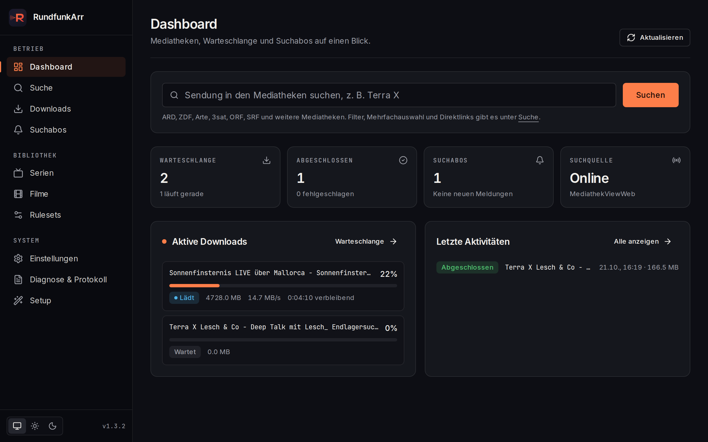
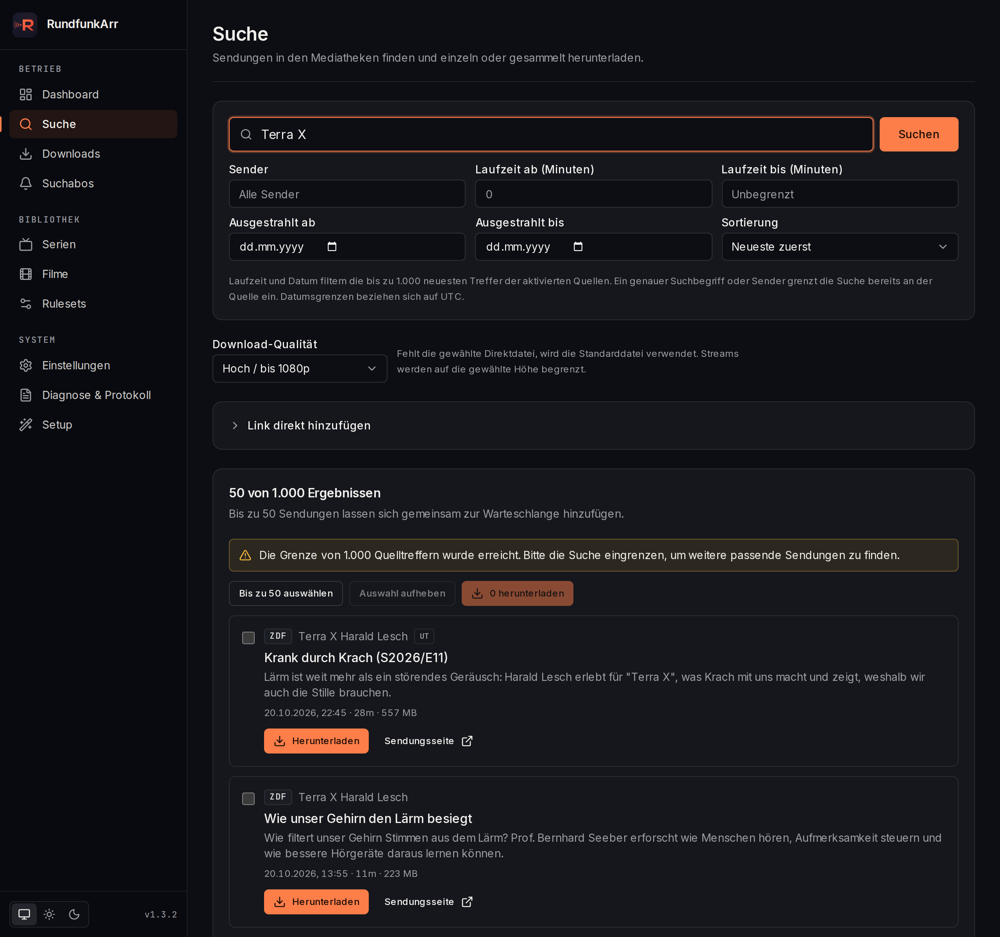
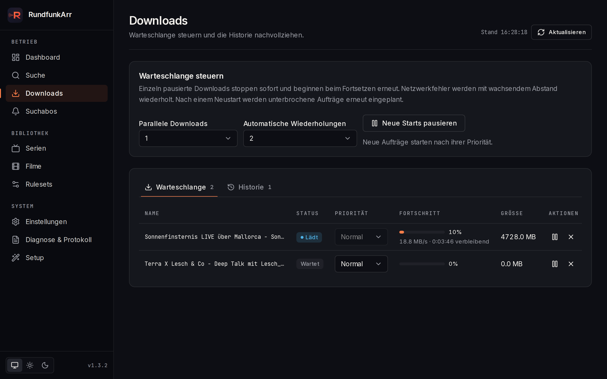
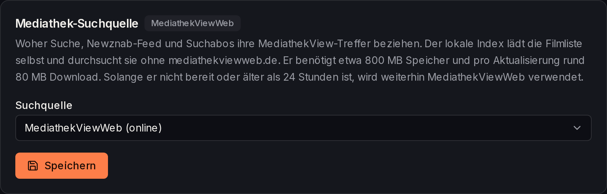
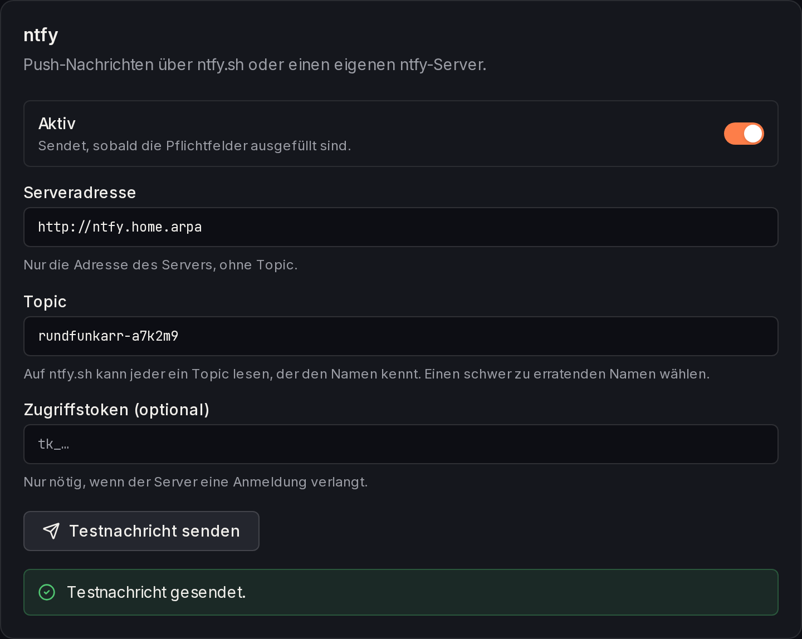

<p align="center">
  
</p>

# RundfunkArr

[](https://github.com/rundfunkarr/rundfunkarr/releases)
[](LICENSE)
[](https://github.com/rundfunkarr/rundfunkarr)
[](https://github.com/rundfunkarr/rundfunkarr/issues)
[](https://rundfunkarr.github.io/rundfunkarr/)

Rundfunk-Indexer für Sonarr/Radarr - Automatischer Download von ARD, ZDF und anderen deutschen Mediatheken.

**Dokumentation:** [rundfunkarr.github.io/rundfunkarr](https://rundfunkarr.github.io/rundfunkarr/)

## Screenshots

<p align="center">
  
</p>

<p align="center">
  
  
</p>

Die Oberfläche folgt der Systemeinstellung für helle oder dunkle Darstellung und lässt sich
unten in der Seitenleiste oder unter Einstellungen → Darstellung umschalten.

## Features

- **Newznab-kompatibler Indexer** - Funktioniert mit Prowlarr, NZB Hydra, Sonarr und Radarr
- **SABnzbd-kompatibler Downloader** - Direkter HTTP-Download von den Mediatheken
- **Optionale MKV-Konvertierung** - FFmpeg-Integration mit deutschen Sprachmetadaten
- **Flexible Metadaten-Quellen** - Lokale Datenbank, TVDB oder TMDB
- **Community-Rulesets** - Lokale Rulesets via Pull Request erweiterbar
- **Benachrichtigungen** - Webhook, ntfy, Gotify und Discord bei fertigen oder fehlgeschlagenen Downloads und neuen Treffern von Suchabos
- **Vorschaubilder** - Standbilder der Sendungen in Suche, Filmen und Suchabos, Poster aus TVDB bei Serien
- **SQLite-Datenbank** - Persistente Speicherung von Cache und Download-Historie

## SRF und ORF über HLS

Aktiviere **HLS-Streams aktivieren** unter Einstellungen → Streaming. Mit
**ORF-Suche aktivieren** werden ORF-Treffer aus MediathekView einbezogen.
Für die SRF-API trägst du Consumer Key und Consumer Secret aus dem
[SRG-SSR-Entwicklerportal](https://developer.srgssr.ch/en/apis/srgssr-video) ein.
Diese Quellen stehen der Websuche und Newznab einschließlich RSS-Sync zur Verfügung.
Die vorhandenen Episodenregeln bestimmen weiterhin, welche Releases Sonarr erhält.

SRF-Videoreferenzen werden erst beim Download durch yt-dlp aufgelöst, einschließlich
der benötigten Stream-Tokens. Ein optionaler Proxy gilt für yt-dlp und Downloads,
jedoch nicht für die SRG-SSR-Metadaten-API. Regionale Beschränkungen hängen weiterhin
vom Proxy-Standort und der Verfügbarkeit beim Sender ab. Viele ORF-Sendungen sind nur
in Österreich abrufbar. Andernfalls liefert ORF statt des Videos einen kurzen
Sperrhinweis; RundfunkArr bricht den Download dann mit dem Fehler „ORF-Geosperre“ ab.
Die MKV-Einstellung gilt auch für HLS: aktiviert ergibt MKV, deaktiviert MP4.
Docker enthält eine feste yt-dlp-Version mit Prüfsummenprüfung. Native Installationen
können einen eigenen Programmpfad oder den ebenfalls geprüften automatischen Download nutzen.

## Lokaler Filmlisten-Index

Unter Einstellungen → Allgemein → **Mediathek-Suchquelle** lässt sich zwischen
**MediathekViewWeb (online)** und dem **lokalen Filmlisten-Index** umschalten. Lokal lädt
RundfunkArr die MediathekView-Filmliste selbst herunter und durchsucht sie, statt jede Suche an
mediathekviewweb.de zu schicken.

<p align="center">
  
</p>

Die Suche verhält sich wie bei MediathekViewWeb
(Wortanfänge, Umlaute als ae/oe/ue, dieselben Filter) und liefert dieselben Treffer.

- Der Index liegt als `filmliste.db` neben der Datenbank (im Docker-Volume `./data`) und
  benötigt etwa 800 MB. Pro Aktualisierung werden rund 80 MB geladen; der Import dauert
  etwa eine Minute.
- Die Liste wird im eingestellten Intervall (Standard: 2 Stunden) geprüft und nur bei einer
  neuen Version geladen.
- Solange der Index nicht bereit ist, die Liste älter als 24 Stunden ist oder eine Suche
  fehlschlägt, nutzt RundfunkArr weiterhin MediathekViewWeb.
- Native Installationen benötigen das Programm `xz` zum Entpacken; das Docker-Image enthält es.
- Ohne Oberfläche lässt sich die Quelle mit der Umgebungsvariablen `MEDIATHEK_SOURCE=local`
  (oder `mediathekviewweb`) festlegen, etwa in der `docker-compose.yml`. Wie bei den
  API-Keys gilt sie nur, solange in den Einstellungen noch nichts gespeichert wurde.

## Post-Processing-Skripte

Wie bei SABnzbd kann nach jedem Download ein eigenes Skript laufen. Es startet, wenn die
Datei samt Untertiteln fertig im Zielordner liegt (also nach einer MKV-Konvertierung) und
bevor Sonarr oder Radarr den Download als abgeschlossen sehen. Solange es läuft, steht der
Download in der Warteschlange auf **Skript läuft** (SABnzbd-Status `Running`).

1. Skript in den Skriptordner legen und ausführbar machen. Standard ist der Ordner `scripts`
   neben der Datenbank, bei Docker also `./data/scripts` auf dem Host:

   ```bash
   mkdir -p data/scripts
   cp mein-skript.sh data/scripts/
   chmod +x data/scripts/mein-skript.sh
   ```

2. Unter Einstellungen → Allgemein → **Post-Processing-Skript** das Skript auswählen und speichern.

Das Skript erhält dieselben Parameter wie bei SABnzbd, sodass vorhandene Skripte weiter
funktionieren:

| Parameter | Inhalt |
|-----------|--------|
| `$1` | Zielordner des Downloads |
| `$2` | Name mit `.nzb`-Endung |
| `$3` | Name des Downloads |
| `$4` | leer (Indexer-ID) |
| `$5` | Kategorie, z. B. `sonarr` |
| `$6` | leer (Newsgroup) |
| `$7` | Status, immer `0` (OK) |
| `$8` | leer |

Zusätzlich gibt es die Umgebungsvariablen `SAB_COMPLETE_DIR`, `SAB_FINAL_NAME`,
`SAB_FILENAME`, `SAB_NZO_ID`, `SAB_CAT`, `SAB_PP_STATUS`, `SAB_STATUS`, `SAB_BYTES` und
`SAB_URL` (Quell-URL der Mediathek). `RUNDFUNKARR_FILE` enthält den vollständigen Pfad der
Videodatei, `RUNDFUNKARR_STORAGE_PATH` denselben Pfad aus Sicht von Sonarr/Radarr
(siehe `DOWNLOAD_FOLDER_PATH_MAPPING`). Das Arbeitsverzeichnis ist der Zielordner.

```sh
#!/bin/sh
# Beispiel: Benachrichtigung per ntfy
curl -s -d "Fertig: $3 ($5)" https://ntfy.sh/mein-thema
```

- Die Ausgabe des Skripts erscheint unter **Diagnose & Protokoll**.
- Ein Exit-Code ungleich 0 macht den Download nicht fehlerhaft. Wie in SABnzbd erscheint
  `Exit(<Code>)` mit der letzten Ausgabezeile als Hinweis in der Historie. Zugangsdaten darin
  werden wie im Protokoll geschwärzt.
- Läuft ein Skript länger als 30 Minuten, wird es beendet; der Download gilt dann mit Hinweis
  als abgeschlossen.
- Wird der Download pausiert oder abgebrochen, während das Skript läuft, endet das Skript
  ebenfalls. Der Download wird dann nicht abgeschlossen, und die fertige Datei wird wieder
  entfernt. Nach dem Fortsetzen wird sie neu geladen.
- Verschiebt oder löscht das Skript die Videodatei, kann Sonarr/Radarr sie nicht mehr
  importieren.
- Das Docker-Image basiert auf Alpine und enthält `sh` und `curl`, aber weder `bash` noch
  Python. Skripte mit `#!/bin/bash` laufen dort nicht.
- Auswählbar sind nur Dateien aus dem Skriptordner. Den Ordner legt ausschließlich
  `POST_PROCESS_SCRIPTS_DIR` fest; über die Weboberfläche lässt er sich nicht ändern.

## Benachrichtigungen

RundfunkArr meldet sich auf Wunsch, wenn etwas passiert. Eingerichtet wird das unter
Einstellungen → **Benachrichtigungen**. Jedes Ziel hat einen Knopf **Testnachricht senden**,
der die gerade eingegebenen Werte prüft, ohne sie zu speichern.

<p align="center">
  
</p>

**Ereignisse** (einzeln abschaltbar, gelten für alle Ziele):

| Ereignis | Inhalt |
|----------|--------|
| Download abgeschlossen | Titel, Sender und Dateiname |
| Download fehlgeschlagen | Titel, Sender und Fehlermeldung, z. B. die ORF-Geosperre |
| Suchabo hat Downloads gestartet | Eine Nachricht pro Prüfung mit allen neu eingereihten Downloads |
| Suchabo hat neue Treffer gefunden | Für Suchabos mit der Aktion „Melden“: eine Nachricht pro Prüfung mit allen neuen Treffern |

Automatische Wiederholungen, Pausen und Abbrüche lösen keine Nachricht aus, erst der
endgültige Fehlschlag. Den Sender speichert RundfunkArr beim Anlegen des Downloads, auch bei
Downloads aus Sonarr, Radarr und der Suche (er steckt in der erzeugten NZB). Nur bei
Downloads, die vor diesem Update eingereiht wurden, oder bei manuell eingegebenen Links
bleibt `channel` leer.

**Ziele** (mehrere gleichzeitig möglich):

| Ziel | Einstellungen |
|------|---------------|
| Webhook | Adresse, optional zusätzliche Header; erhält jedes Ereignis als JSON per `POST` (Format unten) |
| ntfy | Serveradresse (Standard `https://ntfy.sh`), Topic, optional Zugriffstoken |
| Gotify | Serveradresse und App-Token |
| Discord | Webhook-Adresse eines Kanals |

Für den Webhook lassen sich zusätzliche Header angeben, einer pro Zeile im Format
`Name: Wert`, z. B. `Authorization: Bearer …` für einen geschützten Empfänger.
`Content-Type`, `Content-Length` und `Host` (sowie andere Header, die nur der HTTP-Client
setzen darf) lassen sich nicht überschreiben; Werte dürfen nur ASCII-Zeichen ohne
Steuerzeichen enthalten. Ungültige Angaben weist RundfunkArr beim Speichern zurück. Über
`NOTIFY_WEBHOOK_HEADERS` gehen mehrere Header mit Zeilenumbrüchen, in der
`docker-compose.yml` etwa als Block:

```yaml
environment:
  - NOTIFY_WEBHOOK_URL=https://hooks.example.org/rundfunkarr
  - |
    NOTIFY_WEBHOOK_HEADERS=Authorization: Bearer geheim
    X-Quelle: RundfunkArr
```

Ein Ziel sendet, sobald seine Pflichtfelder ausgefüllt sind und es nicht abgeschaltet ist.
Webhook-Adressen, Webhook-Header und Tokens gelten als Zugangsdaten: Die Oberfläche zeigt sie maskiert, und
das Protokoll schwärzt sie, auch im Export. Nachrichten gehen direkt raus, nicht über
den Download-Proxy. Jede Nachricht wird einmal gesendet, mit 10 Sekunden Zeitlimit und
ohne Wiederholung. Ein nicht erreichbares Ziel verzögert keinen Download; der Fehler steht
im Protokoll.

Webhook-Format (Version 1; neue Felder können hinzukommen, bei inkompatiblen Änderungen
steigt `version`):

```json
{
  "version": 1,
  "event": "download.completed",
  "type": "success",
  "title": "Download abgeschlossen",
  "body": "Tatort - Murot und das Murmeltier (ARD)\nDatei: Tatort - Murot und das Murmeltier.mkv",
  "timestamp": "2026-10-29T12:00:00.000Z",
  "download": {
    "id": "6f1c…",
    "title": "Tatort - Murot und das Murmeltier",
    "channel": "ARD",
    "category": "tv",
    "fileName": "Tatort - Murot und das Murmeltier.mkv",
    "filePath": "/downloads/tv/6f1c…/Tatort - Murot und das Murmeltier.mkv",
    "size": 1288490188,
    "warning": null,
    "error": null
  },
  "subscription": null
}
```

- `event`: `download.completed`, `download.failed`, `subscription.queued`,
  `subscription.found` oder `test`
- `type`: `success`, `failure` oder `info` (Feldnamen wie bei Apprise: `title`, `body`, `type`)
- `download`: bei beiden Download-Ereignissen gesetzt, sonst `null`. Bei Fehlschlägen steht
  die Meldung in `error`; `fileName`, `filePath` und `size` sind dann `null`. `filePath` ist
  der Pfad aus Sicht von Sonarr/Radarr (siehe `DOWNLOAD_FOLDER_PATH_MAPPING`).
- `subscription`: bei `subscription.queued` und `subscription.found`, sonst `null`. Enthält
  `id`, `name`, `query`, `downloads` (eingereihte Downloads aus `id`, `title`, `channel`) und
  `matches` (neue Treffer eines Suchabos mit „Melden“ aus `id`, `title`, `channel`,
  `websiteUrl`). Die jeweils nicht zutreffende Liste ist leer.
- Sammelnachrichten nennen höchstens zehn Titel, danach „… und N weitere“; die Listen in
  `subscription` sind vollständig.

## Installation mit Docker

### docker-compose.yml

```yaml
services:
  rundfunkarr:
    image: ghcr.io/rundfunkarr/rundfunkarr:latest
    container_name: rundfunkarr
    environment:
      - TZ=Europe/Berlin
      - PUID=1000                           # User ID (id -u)
      - PGID=1000                           # Group ID (id -g)
      - DOWNLOAD_FOLDER_PATH=/downloads
    volumes:
      - ./data:/app/prisma/data
      - ./downloads:/downloads
    ports:
      - 6767:6767
    restart: unless-stopped
```

Nach dem Start ist die Web-Oberfläche unter `http://localhost:6767` erreichbar. Beim ersten Start führt der **Setup-Wizard** durch die Konfiguration (API Keys, Pfade, etc.).

Für Tests mit dem aktuellen `main`-Stand werden täglich Nightly-Images für `linux/amd64` und `linux/arm64` gebaut. `nightly` zeigt immer auf den neuesten Daily-Build; datierte Tags wie
`nightly-20260517` bleiben als konkreter Build erhalten:

```yaml
image: ghcr.io/rundfunkarr/rundfunkarr:nightly
```

Für reproduzierbare Deployments kann statt `latest` auch eine feste Version verwendet werden:

```yaml
image: ghcr.io/rundfunkarr/rundfunkarr:1.5.0
```

Der Git-Tag-Alias mit `v`-Präfix ist ebenfalls verfügbar:

```bash
docker pull ghcr.io/rundfunkarr/rundfunkarr:v1.5.0
```

Unten in der Seitenleiste und unter Einstellungen → System steht bei Release-Images die
Version (z. B. `v1.4.0`), bei `main`- und Nightly-Images der Kanal mit Commit (z. B.
`main · 5e0d419`).

### Starten

```bash
docker-compose up -d
```

## Manuelle Installation

### Voraussetzungen

- Node.js >= 24
- npm
- FFmpeg (für MKV-Konvertierung)
- xz (nur für den optionalen lokalen Filmlisten-Index)

### Setup

```bash
# Dependencies installieren
npm install

# Datenbank initialisieren
npx prisma migrate dev

# Development Server starten
npm run dev

# Oder Production Build
npm run build
npm start
```

## Konfiguration

### Umgebungsvariablen

| Variable | Beschreibung | Standard |
|----------|--------------|----------|
| `PUID` | User ID für Dateiberechtigungen | `1001` |
| `PGID` | Group ID für Dateiberechtigungen | `1001` |
| `DOWNLOAD_FOLDER_PATH` | Pfad für fertige Downloads im Container | `/downloads` |
| `DOWNLOAD_TEMP_PATH` | Pfad für laufende Downloads (incomplete) | `$DOWNLOAD_FOLDER_PATH/incomplete` |
| `DATABASE_URL` | SQLite Datenbank-Pfad | `file:./prisma/data/rundfunkarr.db` |
| `TVDB_API_KEY` | TVDB-API-Key zum Initialisieren der Einstellungen | leer |
| `TVDB_PIN` | Optionaler TVDB-PIN für Subscriber-Keys | leer |
| `TMDB_API_KEY` | TMDB-API-Key zum Initialisieren der Einstellungen | leer |
| `MEDIATHEK_SOURCE` | Suchquelle zum Initialisieren der Einstellungen: `mediathekviewweb` oder `local` | `mediathekviewweb` |
| `NOTIFY_WEBHOOK_URL` | Webhook-Adresse für Benachrichtigungen | leer |
| `NOTIFY_WEBHOOK_HEADERS` | Zusätzliche Webhook-Header, einer pro Zeile (`Name: Wert`) | leer |
| `NOTIFY_NTFY_URL`, `NOTIFY_NTFY_TOPIC`, `NOTIFY_NTFY_TOKEN` | ntfy-Server, Topic und optionales Token | leer (Server: `https://ntfy.sh`) |
| `NOTIFY_GOTIFY_URL`, `NOTIFY_GOTIFY_TOKEN` | Gotify-Server und App-Token | leer |
| `NOTIFY_DISCORD_WEBHOOK_URL` | Discord-Webhook-Adresse | leer |
| `POST_PROCESS_SCRIPTS_DIR` | Ordner für Post-Processing-Skripte | `scripts` neben der Datenbank (Docker: `/app/prisma/data/scripts`) |
| `DIAGNOSTICS_ADMIN_KEY` | Admin-Schlüssel für Diagnose, Verbindungstest und Protokoll einschließlich Export; mindestens 32 Zeichen | leer (Zugriff gesperrt) |
| `LOG_LEVEL` | Mindeststufe für Server-Logs und das Protokoll: `debug`, `info`, `warn` oder `error` | `info` |

Beim Serverstart werden nichtleere Werte aus `TVDB_API_KEY`, `TVDB_PIN`,
`TMDB_API_KEY`, `DOWNLOAD_FOLDER_PATH`, `MEDIATHEK_SOURCE` und den `NOTIFY_*`-Variablen
in fehlende oder leere Datenbank-Einstellungen übernommen. Bereits gespeicherte Werte haben Vorrang.
Bei lokalen Installationen können die Variablen in `.env` stehen; Docker benötigt
sie unter `environment` oder über `env_file`. Nach Änderungen ist ein Neustart
nötig. Im Build werden keine Werte übernommen. Gespeicherte API-Zugangsdaten
werden in der Settings-API maskiert; die Verbindungstests prüfen sie serverseitig.

`LOG_LEVEL` steuert, wie ausführlich der Server in die Container-Logs und in das
Protokoll unter **Diagnose & Protokoll** schreibt. Mit `info` erscheinen
eingehende Suchanfragen, Ergebnisse, Downloads, Skripte und Imports; `debug`
ergänzt Details zu Suchschritten, Regelwerken, Metadaten-Abfragen und
Downloadschritten. Ungültige Werte werden mit einer Warnung ignoriert.

### Diagnose und Protokoll schützen

Einen zufälligen Admin-Schlüssel mit `openssl rand -hex 32` erzeugen, als
`DIAGNOSTICS_ADMIN_KEY` in der Serverumgebung setzen und den Server neu starten.
Die mitgelieferte Compose-Datei übernimmt den Wert aus `.env`. Ohne gültige
Konfiguration bleiben `/api/logs` und `/api/diagnostics` gesperrt.

Auf **Diagnose & Protokoll** den Schlüssel eingeben. Die Seite behält ihn nur im
Arbeitsspeicher, bis sie gesperrt, verlassen oder neu geladen wird. Auch der
Textexport verlangt den Schlüssel. Direkte API-Aufrufe verwenden den Header
`X-RundfunkArr-Admin-Key`; der Schlüssel gehört nicht in die URL. Außerhalb eines
vertrauenswürdigen Netzes HTTPS verwenden.

Freigeschaltete Administratoren können interne Sonarr-/Radarr-Adressen testen,
auch Docker-Hostnamen und Loopback-Adressen. Weiterleitungen werden abgelehnt;
der Admin-Schlüssel wird nicht an die Zielanwendung gesendet. Dieser Schutz gilt
nur für Diagnose und Protokoll, nicht für die übrige Anwendung.

Bei aktivierter Anmeldung ist zusätzlich eine gültige Browser-Sitzung erforderlich.
Direkte schreibende API-Aufrufe benötigen außerdem einen passenden `Origin`-Header.
Der Integrationsschlüssel für Sonarr/Radarr ersetzt weder die Sitzung noch den
Diagnose-Schlüssel.

### Optionale Anmeldung

Unter **Einstellungen → Allgemein → Sicherheit** lässt sich ein Anmeldeformular mit
Benutzername und Passwort aktivieren. Standardmäßig ist die Anmeldung aus, damit
bestehende Installationen unverändert starten. Neue Passwörter benötigen mindestens
12 Zeichen und werden ausschließlich als gesalzener scrypt-Hash gespeichert.

Bei aktivierter Anmeldung gelten folgende Zugriffswege:

- Browser: Loginformular; die Sitzung läuft nach 12 Stunden ab, mit „30 Tage
  angemeldet bleiben“ nach 30 Tagen. Abmelden widerruft die Sitzung auf dem Server.
- Sonarr/Radarr/Prowlarr: den **Integrationsschlüssel** aus den Sicherheitseinstellungen
  als API-Key sowohl im RundfunkArr-Newznab-Indexer als auch im SABnzbd-Download-Client
  eintragen. Vorher beliebige Werte funktionieren dann nicht mehr. `apikey` als
  URL-Parameter und `X-Api-Key` als Header werden unterstützt.
- Der Integrationsschlüssel gilt nur für die SABnzbd-/Newznab-Schnittstellen, nicht
  für die Verwaltungs-API. NZB-Links aus authentifizierten Suchantworten erhalten
  eine Signatur für genau diese Datei, damit der Download ohne Browsercookie gelingt.
- Interne Adressen und Docker-Netze bleiben nutzbar. Es gibt keine automatische
  Anmeldeausnahme für lokale Adressen oder `X-Forwarded-For`.
- `/api/health` bleibt für Container-Healthchecks ohne Anmeldung erreichbar und
  liefert ausschließlich einen allgemeinen Status.

Bei jedem Wechsel von deaktivierter zu aktivierter Anmeldung wird der
Integrationsschlüssel automatisch ersetzt, auch beim erneuten Aktivieren eines
vorhandenen Kontos. Den neuen Wert **nach dem Speichern** in den verbundenen
Anwendungen eintragen; alte Schlüssel und NZB-Links werden ungültig.
Änderungen bei bereits aktivierter Anmeldung erfordern das aktuelle Passwort und
melden andere Sitzungen ab. Dabei bleibt der Integrationsschlüssel erhalten,
sofern nicht ausdrücklich ein neuer erzeugt wird. Das Abschalten öffnet Oberfläche
und APIs wieder, daher vorher die Erreichbarkeit auf ein vertrauenswürdiges Netz
begrenzen.

Für Zugriff außerhalb eines vertrauenswürdigen Netzes HTTPS verwenden. Hinter
einem Reverse Proxy `AUTH_PUBLIC_URL` auf den öffentlichen Ursprung setzen, etwa
`https://rundfunk.example.com` (ohne Pfad). Das erlaubt die Prüfung von Browseranfragen
und setzt bei HTTPS sichere Sitzungscookies. `AUTH_COOKIE_SECURE=true` erzwingt
sichere Cookies zusätzlich. Der Proxy muss den Hostnamen weitergeben. Cookies sind
HttpOnly und SameSite=Strict; Passwörter und Sitzungstoken werden nicht im
Browserspeicher abgelegt.

Für öffentlich erreichbare Installationen zusätzlich die Anmeldeversuche am
Reverse Proxy pro tatsächlicher Client-Adresse begrenzen. RundfunkArr reserviert
für Passwortprüfungen ein festes Zwei-Sekunden-Fenster; falsche Passwörter und
abgewiesene Versuche verlängern es nicht. Diese gemeinsame Begrenzung schützt
die Rechenkapazität, verhindert aber keine gezielt getaktete Blockierung neuer
Anmeldungen. Bestehende Sitzungen bleiben dabei nutzbar.

Beispiel für [NGINX-Anfragelimits](https://nginx.org/en/docs/http/ngx_http_limit_req_module.html):
Die ersten beiden Direktiven gehören in den `http`-Kontext; den `location`-Block
in den vorhandenen HTTPS-Server integrieren und das Proxy-Ziel anpassen.

```nginx
map $uri $rundfunkarr_login_client {
    default "";
    ~^/api/auth/login/?$ $binary_remote_addr;
}
limit_req_zone $rundfunkarr_login_client zone=rundfunkarr_login:10m rate=5r/m;

location / {
    limit_req zone=rundfunkarr_login burst=5 nodelay;
    limit_req_status 429;
    proxy_set_header Host $http_host;
    proxy_pass http://rundfunkarr:6767;
}
```

Nur Login-Anfragen verbrauchen dieses Limit. Den RundfunkArr-Port von außen
ausschließlich über diesen Proxy erreichbar machen. Ist ein weiterer Proxy oder
ein CDN vorgeschaltet, dessen feste Adressen über
[`set_real_ip_from`](https://nginx.org/en/docs/http/ngx_http_realip_module.html#set_real_ip_from)
als vertrauenswürdig konfigurieren; vom Client gesetzte `X-Forwarded-For`-Werte
dürfen keine neuen Limit-Gruppen erzeugen.

Docker legt die Authentifizierungstabellen beim Start auch für vorhandene
Datenbanken an. Bei nativer Installation vor dem Start `npx prisma migrate deploy`
oder den bereits verwendeten `npx prisma db push`-Ablauf ausführen.

**Passwort vergessen:** Auf dem Server mit Zugriff auf dieselbe Datenbank
`node scripts/reset-auth.mjs --confirm` ausführen; im Container entsprechend
`docker exec rundfunkarr node /app/scripts/reset-auth.mjs --confirm`.
Das deaktiviert die Anmeldung, löscht das Passwort, widerruft alle Sitzungen und
ersetzt den Integrationsschlüssel. Danach im vertrauenswürdigen Netz ein neues
Konto konfigurieren. Ein Neustart allein löscht keine Anmeldung.

### Web-Oberfläche

RundfunkArr bietet eine vollständige Web-Oberfläche mit:

- **Dashboard** - Schnellsuche, Statuskacheln, aktive Downloads und letzte Aktivitäten
- **Suche** - Direkte Suche in den Mediatheken mit Filtern, Mehrfachauswahl und Direktlinks
- **Downloads** - Warteschlange steuern und Historie verwalten
- **Suchabos** - Suchbegriffe regelmäßig prüfen und neue Sendungen melden oder laden
- **Serien** und **Filme** - Zwischengespeicherte Serien aus TVDB und Filmsuche in den Mediatheken
- **Rulesets** - Zuordnungsregeln ansehen, prüfen und lokal überschreiben
- **Einstellungen** - Alle Einstellungen konfigurieren:
  - Download-Pfad, Qualitäts-Präferenzen, Untertitel und optionale MKV-Konvertierung
  - API Keys für TVDB/TMDB/SRG-SSR
  - Matching-Strategie und Schwellwerte
  - Benachrichtigungen per Webhook, ntfy, Gotify und Discord
  - Cache-TTL Einstellungen
  - Darstellung: Farbschema, Vorschaubilder und Serienposter
- **Diagnose & Protokoll** - Systemdiagnose, Verbindungstest und Serverprotokoll
- **Setup-Wizard** - Geführte Erstkonfiguration

#### Vorschaubilder

Suche, Filme und Suchabos zeigen zu jedem Treffer ein Standbild. MediathekView liefert keine
Bilder, deshalb ruft RundfunkArr beim ersten Anzeigen die Sendungsseite des Senders einmal ab,
liest dort die Adresse des Vorschaubilds (`og:image`) aus und merkt sie sich in der Datenbank
(30 Tage, bei Fehlschlag einen Tag). Das Bild selbst lädt der Browser direkt vom Sender.
Abgerufen werden nur Seiten der öffentlich-rechtlichen Sender; SRF-Bilder kommen aus der
SRG-SSR-API, Serienposter aus TVDB. Unter Einstellungen → **Darstellung** lassen sich
Vorschaubilder und Serienposter getrennt abschalten; ohne Vorschaubilder ruft RundfunkArr keine
Sendungsseiten ab. Dort lässt sich auch das Farbschema (System, Hell, Dunkel) wählen.

### Metadaten-Quellen

RundfunkArr sucht Show-Informationen in folgender Reihenfolge:

1. **Lokale Datenbank** (`data/shows.json`) - Kein API Key nötig
2. **TVDB** - Wenn in den Einstellungen konfiguriert (Project API Key ohne PIN oder Subscriber-Key mit optionalem PIN)
3. **TMDB** - Wenn in den Einstellungen konfiguriert (kostenlos)

Für Shows die nicht in TVDB/TMDB sind, können Einträge in `data/shows.json` hinzugefügt werden.

## API Endpoints

### Indexer (Newznab)

| Endpoint | Beschreibung |
|----------|--------------|
| `GET /api/newznab?t=caps` | Capabilities XML |
| `GET /api/newznab?t=tvsearch&tvdbid=123` | TV-Suche nach TVDB ID |
| `GET /api/newznab?t=tvsearch&q=Tatort` | TV-Suche nach Name |
| `GET /api/newznab?t=search` | RSS Feed |

### Downloader (SABnzbd-kompatibel)

| Endpoint | Beschreibung |
|----------|--------------|
| `GET /api?mode=version` | Version |
| `GET /api?mode=get_config` | Konfiguration |
| `GET /api?mode=queue` | Download-Queue |
| `GET /api?mode=history` | Download-Historie |
| `POST /api?mode=addfile&cat=sonarr` | Download hinzufügen |

## Sonarr/Radarr Einrichtung

### Als Indexer (in Prowlarr oder direkt)

1. Indexer hinzufügen → Generic Newznab
2. URL: `http://rundfunkarr:6767/api/newznab`
3. API Key: bei aktivierter Anmeldung der Integrationsschlüssel aus den Sicherheitseinstellungen, sonst beliebig

### Als Download Client

1. Download Client hinzufügen → SABnzbd
2. Host: `rundfunkarr`
3. Port: `6767`
4. API Key: bei aktivierter Anmeldung der Integrationsschlüssel aus den Sicherheitseinstellungen, sonst beliebig

Prowlarr synchronisiert nur den Indexer zu Sonarr und Radarr. Richte RundfunkArr
als Download Client zusätzlich direkt in jeder *arr App ein. Ein in Prowlarr
konfigurierter Download Client wird nur für manuelle Downloads aus Prowlarr
verwendet.

## Rulesets & Shows hinzufügen

### Neue Show hinzufügen

1. Show in `data/shows.json` hinzufügen:
```json
{
  "tvdbId": 123456,
  "name": "Show Name",
  "germanName": "Deutscher Name",
  "aliases": [],
  "episodes": [
    { "name": "Episode 1", "seasonNumber": 1, "episodeNumber": 1, "aired": "2024-01-01" }
  ]
}
```

2. Ruleset in `data/rulesets.json` hinzufügen:
```json
{
  "id": 1001,
  "mediaId": 1001,
  "topic": "Mediathek Topic Name",
  "priority": 0,
  "filters": "[{\"attribute\":\"duration\",\"type\":\"GreaterThan\",\"value\":\"30\"}]",
  "titleRegexRules": "[]",
  "episodeRegex": "(?<=E)(\\d{2})(?=\\))",
  "seasonRegex": "(?<=S)(\\d{2})(?=/E)",
  "matchingStrategy": "SeasonAndEpisodeNumber",
  "media": {
    "media_id": 1001,
    "media_name": "Show Name",
    "media_type": "show",
    "media_tvdbId": 123456,
    "media_tmdbId": null,
    "media_imdbId": null
  }
}
```

3. Pull Request erstellen

### Regex execution limits

Custom and community rule expressions run in a separate worker with a 100 ms
execution limit, both in the preview and in regular searches. JavaScript regex
syntax, including lookarounds and backreferences, remains supported. A timed-out
expression aborts the current evaluation and is rejected for one minute; simplify
the expression before trying again. The preview displays an error rather than an
incomplete set of matches.

The shared worker accepts at most 64 pending evaluations, with a maximum queue
wait of two seconds. Expressions are limited to 4,096 characters and input fields
to 65,536 characters (UTF-16 code units); oversized values are rejected, never
truncated. The rule editor retains its tighter 300-character expression limit.

## Entwicklung

```bash
# Development mit Hot Reload
npm run dev

# TypeScript Check
npx tsc --noEmit

# Lint
npm run lint

# Datenbank-Migration erstellen
npm run db:migrate
```

## Projektstruktur

```
src/
├── app/               # Next.js App Router
│   ├── api/           # API Routes
│   │   ├── newznab/   # Indexer API (Newznab)
│   │   ├── settings/  # Settings API
│   │   └── route.ts   # Downloader API (SABnzbd)
│   ├── settings/      # Settings Page
│   ├── setup/         # Setup Wizard
│   ├── search/        # Search Page
│   └── downloads/     # Downloads Page
├── components/        # React Components
│   └── layout/        # Sidebar, Navigation
├── contexts/          # React Context
│   └── settings-context.tsx
├── services/          # Business Logic
│   ├── mediathek/     # Mediathek-Suche, Regelabgleich, Filmsuche
│   ├── shows.ts       # Unified Show Lookup
│   ├── tvdb.ts        # TVDB API
│   ├── tmdb.ts        # TMDB API
│   ├── newznab.ts     # RSS/XML Generation
│   └── rulesets.ts    # Matching Rules
├── server/            # Server-Side Only
│   ├── download-manager.ts
│   ├── ffmpeg.ts
│   └── filmliste/     # Lokaler Filmlisten-Index (Import, SQLite-Suche)
└── lib/               # Utilities
    ├── db.ts          # Prisma Client
    ├── cache.ts       # Dynamic TTL Caches
    └── settings.ts    # Settings Helper
data/
├── shows.json         # Lokale Show-Datenbank
└── rulesets.json      # Matching Rulesets
```

## Credits

- [PCJones/MediathekArr](https://github.com/PCJones/MediathekArr) - Original .NET Implementation
- [MediathekViewWeb](https://github.com/mediathekview/mediathekviewweb) - Mediathek API
- [TheTVDB](https://thetvdb.com) - Metadaten API
- [TMDB](https://www.themoviedb.org) - Metadaten API

## Lizenz

MIT
